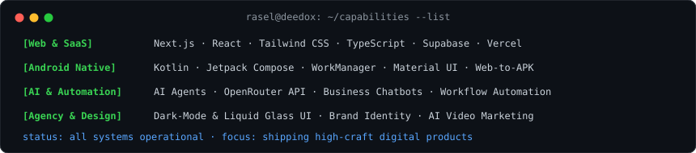
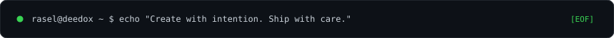

  

<h3><code>rasel@github ~ $ ./contributions.sh</code></h3>

  

<h3><code>rasel@github ~ $ whoami</code></h3>
<table>
  <tr>
    <td valign="top"></td>
    <td valign="top"></td>
  </tr>
</table>

  

<h3><code>rasel@github ~ $ ls -la ./featured-projects/</code></h3>

  

<h3><code>rasel@github ~ $ cat ./skills-and-agency.conf</code></h3>

  

# Hi 👋, I'm Rasel Ahmed | DEEDOX

### 🚀 AI-Powered Full-Stack Developer | AI Agent & Automation Builder

  

<!-- Profile Stats & Status Badges -->

  
  
  
  

<!-- Smart AI & Tech Specialty Tags Linked with Web & Video URLs -->

  
  
  
  
  
  

- 🤖 I build **AI-powered web apps, Android apps, AI Agents, and smart automation workflows**
- 👨‍💻 All of my projects are available at **[https://deedoxstudio.com/](https://deedoxstudio.com/)**
- 📝 I regularly write articles on **[https://deedoxstudio.com/](https://deedoxstudio.com/)**

<h3 align="left">Connect with me:</h3>

  
  &nbsp;
  

<h3 align="left">Languages and Tools:</h3>

  

<h3 align="left">GitHub Stats:</h3>

  

